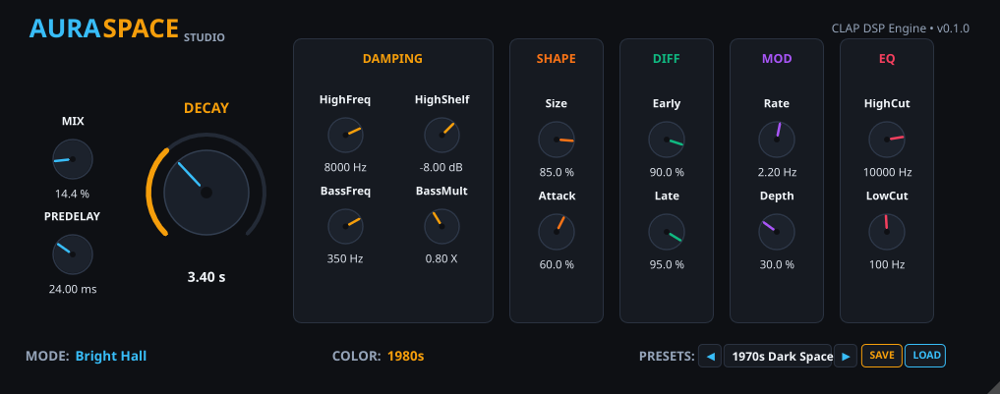

# AuraSpace

**AuraSpace** is a high-performance, vintage algorithmic reverb audio plugin for Linux, written in 100% safe, modern Rust using the **CLAP** (CLever Audio Plugin) standard and the **Vizia** GUI framework.

Featuring a modulated **Jon Dattorro (MVerb) Figure-of-Eight** tank topology with vintage converter color modeling (1970s, 1980s, and Modern NOW modes), AuraSpace combines lush vintage spatial diffusion with modern stereo SIMD optimization and a dedicated studio rack vector interface.

<p align="center">
  
</p>

---

## Highlights & Features

- **Ultra-Lightweight DSP (< 1% CPU)**: 
  - Block-rate precomputed filter and loop coefficients eliminate expensive trigonometric calculations from the sample loop.
  - Achieves over **117x real-time throughput** on standard CPUs.
- **Stereo SIMD Parallel Processing**:
  - Damping and output EQ stages process stereo channel pairs simultaneously in vector registers.
  - Parallel 2-channel parabolic LFO sine approximation with zero lookup table overhead.
- **Zero-Latency Silence Detection & Sleep Mode**:
  - Intelligent input/output level monitoring ($-100\text{ dB}$ threshold).
  - Automatically signals `ProcessStatus::Tail` during decay and drops to `ProcessStatus::Normal` (**0.00% CPU**) when the reverb tail has settled.
- **Crash-Proof & Denormal-Safe**:
  - Hardware FTZ (Flush-To-Zero) and software subnormal clamping.
  - Full input sanitization against `NaN` and `±Infinity` (complete protection against "NaN-poisoning" in the feedback tank).
- **Flexible Channel Layouts**:
  - **Stereo In $\rightarrow$ Stereo Out**: Standard stereo tracking and bus processing.
  - **Mono In $\rightarrow$ Stereo Out**: Classic send-reverb workflow (blooms mono vocals, leads, and drums into a lush, wide stereo soundstage).
  - **Mono In $\rightarrow$ Mono Out**: Pure mono tracks with phase-aligned stereo-tap summing.
- **Original 'Aura Studio' Vector UI**:
  - Sleek brushed obsidian / dark graphite modular rack chassis.
  - Custom **Aura Orbital Decay Dial** with radiant solar gold arc and cyan precision needle.
  - Color-coded frequency and modulation rack modules.
  - Interactive clickable mode toggles and preset browser.
- **Built-in Preset System**:
  - 8 curated factory presets.
  - Save and load `.json` preset files via native system file dialogs (`rfd`).
  - Automatic directory synchronization in `~/.config/aura_space/presets/`.

---

## The Three Color Modes

AuraSpace models the converter architectures and bandwidth limitations of distinct audio production eras:

| Color Mode | Bandwidth | Resolution & Dither | Saturation & Character |
| :--- | :--- | :--- | :--- |
| **1970s** | 10.5 kHz steep 4-pole low-pass | 12-bit signed with TPDF dither | Warm analog soft-clipping saturation in the tank loop |
| **1980s** | 16.0 kHz steep 4-pole low-pass | 16-bit signed with TPDF dither | Subtle analog warmth, pristine 80s plate character |
| **NOW** | Full Nyquist (up to 192 kHz+) | 32-bit floating-point transparency | Linear, ultra-clean modern studio reverb |

---

## Reverb Modes

- **Concert Hall**: Large, cavernous acoustic space with lush, spatial diffusion.
- **Bright Hall**: Slightly shorter initial build-up with airy, open top end.
- **Plate**: Ultra-dense, rapid attack suitable for snares, vocals, and percussive transients.
- **Room**: Intimate acoustic space with controlled room decay and enhanced early reflections.

---

## Parameters

| Section | Parameter | Range | Description |
| :--- | :--- | :--- | :--- |
| **Main** | **Mix** | 0.0 % – 100.0 % | Dry / Wet balance |
| | **PreDelay** | 0.0 ms – 500.0 ms | Initial delay time before reverb onset |
| | **Decay** | 0.2 s – 70.0 s | $T_{60}$ reverberation decay time (Orbital dial) |
| **Damping** | **HighFreq** | 1000 Hz – 20000 Hz | High-frequency damping cutoff |
| | **HighShelf** | -24.0 dB – 0.0 dB | High-shelf attenuation in feedback loop |
| | **BassFreq** | 10 Hz – 1000 Hz | Low-frequency crossover point |
| | **BassMult** | 0.25 X – 4.0 X | Decay multiplier for low frequencies |
| **Shape** | **Size** | 0.0 % – 100.0 % | Scales delay line capacities dynamically |
| | **Attack** | 0.0 % – 100.0 % | Crossfade between direct signal and input diffusion |
| **Diff** | **Early** | 0.0 % – 100.0 % | 4-stage input allpass diffusion density |
| | **Late** | 0.0 % – 100.0 % | Tank feedback allpass diffusion balance |
| **Mod** | **Rate** | 0.05 Hz – 10.0 Hz | LFO modulation frequency |
| | **Depth** | 0.0 % – 100.0 % | Delay modulation excursion |
| **EQ** | **HighCut** | 1000 Hz – 20000 Hz | Post-reverb master low-pass filter |
| | **LowCut** | 10 Hz – 1000 Hz | Post-reverb master high-pass filter |
| **Mode** | **Mode** | Enum | Concert Hall, Bright Hall, Plate, Room |
| **Color** | **Color** | Enum | 1970s, 1980s, NOW |

---

## Installation

### Precompiled Binary (Recommended)

Download `aura-space.clap` from the [Releases](https://github.com/kiklabautermann/aura-space/releases) page and copy it into your user CLAP directory:

```bash
mkdir -p ~/.clap
cp aura-space.clap ~/.clap/
```

Launch your CLAP-compatible DAW (e.g., Bitwig Studio, REAPER) and rescan plugins.

---

## Building from Source

### Prerequisites

- **Rust toolchain** (Rust 1.75+ or newer, Edition 2021):
  ```bash
  curl --proto '=https' --tlsv1.2 -sSf https://sh.rustup.rs | sh
  ```
- **Linux development dependencies** (X11, XCB, OpenGL):
  ```bash
  sudo apt-get install build-essential pkg-config libx11-dev libxcb1-dev libgl1-mesa-dev
  ```

### Build & Deploy

Clone the repository and build the release binary:

```bash
git clone https://github.com/kiklabautermann/aura-space.git aura-space
cd aura-space

# Run release build and automatic deployment
./deploy.sh
```

Or build manually with Cargo:

```bash
cargo build --release
```

The compiled shared library will be located at:
`target/release/libaura_space.so`

Copy and rename to:
`~/.clap/aura_space.clap`

### Running Tests

```bash
cargo test
```

A comprehensive test suite verifies:
- Allpass filter stability and energy preservation.
- Color engine 12/16-bit dither and saturation characteristics.
- Multi-tap stereo readout and $T_{60}$ decay impulse responses.
- Silence detection and sleep mode state transitions.
- Fuzzing and resilience against `NaN`, `±Inf`, and extreme sample rates.
- JSON preset serialization and sanitization.
- Dynamic CLAP library loader verification.

---

## Credits & References

- **Jon Dattorro**: Reverb tank topology based on the seminal paper:
  *Jon Dattorro, "Effect Design, Part 1: Reverberator and Other Filters", Journal of the Audio Engineering Society (JAES), Vol. 45, No. 9, September 1997.*
- **CLAP Standard**: Developed by the [CLAP team](https://cleveraudio.org/) (Free-*, Alexandre Bique, Urs Heckmann, et al.) under the MIT license.
- **NIH-plug Framework**: Created by [Robbert van der Helm](https://github.com/robbert-vdh/nih-plug) under the ISC license.
- **Vizia GUI Library**: Developed by [Georgero, Colin Finck, and contributors](https://github.com/vizia/vizia) under the MIT license.
- **Martin Eastwood (MVerb)**: For popularizing the open-source Dattorro figure-of-eight implementation in modern audio plugin development.

---

## Disclaimer & Trademarks

All product names, logos, brands, and registered trademarks mentioned in this repository are property of their respective owners. Their mention is solely for descriptive and comparative purposes to explain algorithmic design and parameter behaviors. **AuraSpace** is an independent, original open-source project.

---

## License

This project is licensed under the [MIT License](LICENSE).
